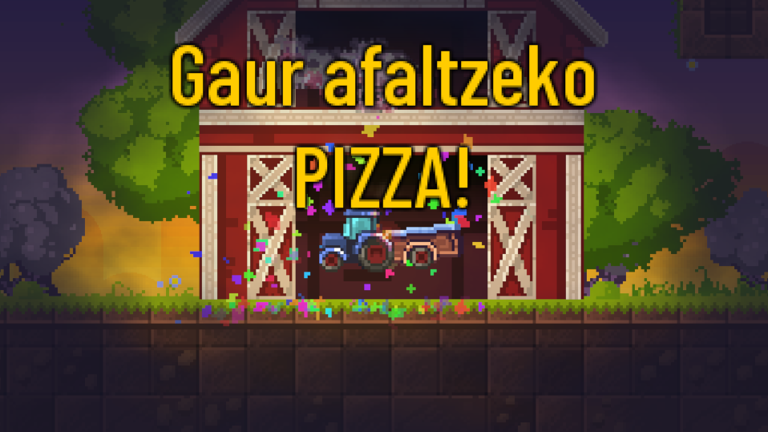

# BUKAERAKO MEZUA ALDATU

Bildu beharreko elementu guztiak (behi, egur eta sagarrak) baserrira eramatean, zoriontzeko mezu bat agertzen da. Defektuz "Zorionak!" jarriko du.

Mezu hori aldatu nahi izanez gero, bistaratu nahi den testua `--mezua` parametroarekin pasatu beharko zaio jokoari exekutatzeko momentuan. Lerro saltoa jartzeko '::' testua jarri beharko da. Adibidez:

- PetitTracteurBlew.exe --mezua="Lortu duzu!"
- PetitTracteurBlew.exe --mezua="Gaur afaltzeko::PIZZA!"

Euskarazko bertsioa [hemendik](https://github.com/josuigoa/petitTracteurBleu/releases/tag/1.0.0) deskargatu dezakezu.

## PANTAILA ALDATZEN / SORTZEN

Jokoko pantaila bakarra [LDtk](https://ldtk.io/) programarekin egina da. Pantailaren datuak `res/world/petitTracteurBleu.ldtk` fitxategian daude ta LDtk-ren 1.5.3 bertsioarekin ongi zabaltzen da.

# About

You are Little Blue Tractor and your goal is to find all the cows and bring them back home before night falls (the game lasts about 3 mins).

“Petit Tracteur Bleu” is a game I created for my 2.5 years old son, Gabriel, because he loves tractors. So please, don’t expect anything crazy here, it’s just a very simple game :)

It was designed to be played by someone who never played a video game before, and most movements are automated. The manual jump mechanic is only useful to explore hidden areas (using bumpers).

# Compiling

Please refer to my `GameBase` project to build this one:

https://deepnight.net/tutorial/using-my-gamebase-to-create-a-heaps-game/
